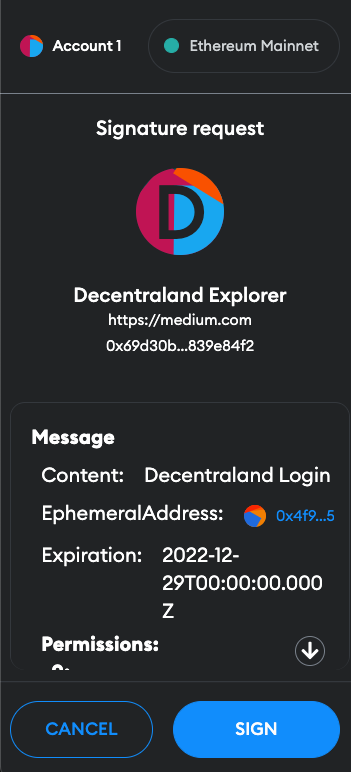
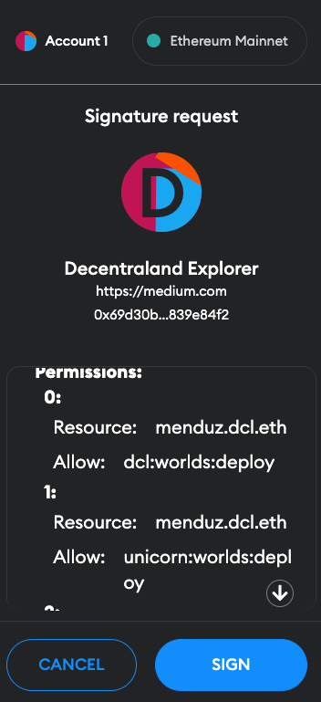
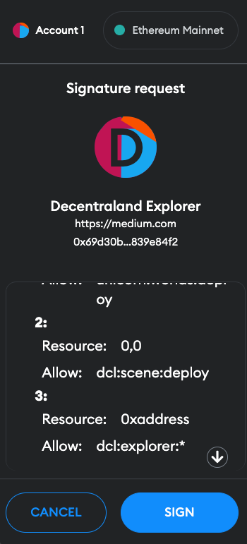

## Abstract

This document discusses the creation and use of ephemeral keys for signing
service requests or operations on behalf of users in the Decentraland platform.
It proposes the use of a set of permissions to be associated with the ephemeral
key in order to ensure that it can only be used for specific types of requests (
for e.g. profile deployments).

The document explores various options for specifying and reading these
permissions, including using a structure similar to Amazon's AWS IAM service and
using human-readable text that can also be machine-parsed. The goal of these
measures is to ensure that ephemeral keys are used in a way that follows the
principle of least privilege, and to allow users to sign keys that grant access
only to the specific types of operations they wish to authorize.

## Context, Reach & Prioritization

When signing in to Decentraland an ephemeral key is created and the user
signs it using Metamask / WalletConnect / etc. That ephemeral key is
then used by the Explorer to sign deployment of entities on behalf of the user,
like for profile updates. For e.g.

```json
{
  "version": "v3",
  "localTimestamp": 1672836992842,
  "authChain": [
    {
      "type": "SIGNER",
      "payload": "0xed93e62f69c386617003ca0c8d78faca37a73912",
      "signature": ""
    },
    {
      "type": "ECDSA_EPHEMERAL",
      "payload": "Decentraland Login\r\nEphemeral address: 0x9272b45a74942068e6Ebe3e326dc065F7C28e41d\r\nExpiration: 2023-01-09T09:11:13.802Z",
      "signature": "0x827970db4cab26dd0b4743d4eff58c0e3401c400b50362421694b9d070ac624c7da889fa726c38429e8896c5de127666a33786d0c821aef2eea548029e7407eb1c"
    },
    {
      "type": "ECDSA_SIGNED_ENTITY",
      "payload": "bafkreigwzkkzrpkjugifokndlmvwsqfvpmoogthuol2zij67s7hj3flaxq",
      "signature": "0x67f77d86e3e91459469110c2be16682d0c9ff57e402df6d0396033676d087f72334cbcc29972968311c5987660c58ac4d14876792c354bbd864e0302a6cce53f1c"
    }
  ]
}
```

The ephemeral key has an expiration date and can be used for signing any
kind of deployments on behalf of the user while the key is not expired. A
malicious user could attempt to use it for deploying other kind of entities
on behalf of the user, such as scenes in the Catalyst Network or a scene for
a World using a DCL name.

Following the principle of the least privilege it would be useful to be able
to grant the ephemeral key only the set of permissions that are required
for the purpose of the client using it.

* In case of Explorer, just deploying profiles should be enough.
* When using `dcl deploy` the only permissions
  required are for deploying scenes (or wearables? emotes?). Not needed for
  deploying profiles. However, in this case, no ephemeral key is used but
  rather the deployment is signed directly with the user wallet.

So this proposal is about extending the Auth Chain to support the creation
of the ephemeral key with a given set of permissions associated to it, and
that the server that receives those requests can validate that the user granted
access to the scopes required for the operation being requested. This way, the
user could sign the ephemeral key to only allow deployment of worlds under a
certain name but not deployment of profiles nor scenes in the Catalyst network.

It is worth mentioning that this does not have any effect or implications on
Auth Chains in which there is no ephemeral key, but rather the user signs the
request directly. This is usually the case for scene deployments. For e.g.:

```json
{
  "version": "v3",
  "localTimestamp": 1669232361483,
  "authChain": [
    {
      "type": "SIGNER",
      "payload": "0xe2b6024873d218b2e83b462d3658d8d7c3f55a18",
      "signature": ""
    },
    {
      "type": "ECDSA_SIGNED_ENTITY",
      "payload": "bafkreignljg5bvmzczke42gymktbraf7py7riwyclmbgzmwcyswxdgktju",
      "signature": "0x82ccde2c7c6b300566c40fd6f3234876614564a6e13643e968fe4f69828a2fb41e8286fbf94ac92a19a5dfb96ff636a2d5e41406d5dfc200e76145cc4b0d96321c"
    }
  ]
}
```

## Solution Space Exploration

### Permission specification

Permissions must be specified when creating an ephemeral key. A simple and very
flexible way for this could be similar to how Amazon does it
in [AWS IAM](https://aws.amazon.com/iam/). In this case, it would consist of
a collection of a resource name and either an allow or deny expression.

For e.g.:

```yaml
Permissions:
  - resource: "my-dcl-name.dcl.eth"
    allow: "dcl:worlds:deploy"
  - resource: "0,0"
    allow: "dcl:scene:deploy"
  - resource: "0xaddress"
    allow: "dcl:explorer:*"
  - resource: "0xaddress"
    deny: "dcl:explorer:denied-operation"
```

The `resource` name must be an item referencing an entity of the domain that
the server knows. For e.g. for DCL Worlds, it can be a DCL name, while for
scene deployment in Genesis City it can be the coordinates of the land, or
for a profile deployment it can be the profile address.

The `allow` and `deny` elements are structured as follows:
`namespace:service-name:operation-name` or `namespace:service-name:*`.
The namespace is used to for prefixing all the services that belong to an
organization. For e.g., in Decentraland the prefix could be `dcl`. The
second part, the service name, refers to the service that this permission
declaration is intended for. It has to be unique for services within the
same namespace. The last part can be either a single operation name or a `*`
character meaning any possible operation for the service.

In the example above, resource `0xaddress` allows `dcl:explorer` to do any
operations except `denied-operation`. A single operation name always weighs
more than the wildcard operator, and hence takes precedence over it.

### Permission readability

One of the key points in the permission specification is that they must be
human-readable, because the user signing the creation of the ephemeral key needs
to be able to read it in plain text and understand what he is about to sign.

On the other hand, the text has to be machine parsable so that the server is
able to parse the message signed by the user that contains the permission
specification and be able to interpret it for allowing or disallowing the
operation request accordingly.

Here is a few options proposed for permission specification. Options 1 and 2
propose different payload options to be
signed, based
on [EIP-4361 Sign-In with Ethereum](https://eips.ethereum.org/EIPS/eip-4361).

Option 1: more yaml-like:

```text
Decentraland Login
Ephemeral address: 0x4f9c4Ff265357F937B14BCd1E5519f1537985301
Expiration: 2022-12-29T00:00:00.000Z

Permissions:
  - resource: "menduz.dcl.eth"
    allow:    "dcl:worlds:deploy"
  - resource: "menduz.dcl.eth"
    allow:    "unicorn:worlds:deploy"
  - resource: "0,0"
    allow:    "dcl:scene:deploy"
  - resource: "0xaddress"
    allow:    "dcl:explorer:*"
```

Option 2: yaml-like list of parsable phrases:

```text
Decentraland Login
Ephemeral address: 0x4f9c4Ff265357F937B14BCd1E5519f1537985301
Expiration: 2022-12-29T00:00:00.000Z

Permissions:
- allow "dcl:worlds:deploy" for menduz.dcl.eth
- allow "dcl:explorer:*" for 0xaddress
- deny "dcl:explorer:voice" for 0xaddress
- deny "dcl:explorer:voice2" for 0xaddress
- allow "unicorn:worlds:deploy" for menduz.dcl.eth
- allow "dcl:scene:deploy" for *
```

Option 3: Typed structured data

An alternative approach to permission specification would be to use structured
data signing, as defined in
[EIP-712 Typed structured data hashing and signing](https://eips.ethereum.org/EIPS/eip-712).

The follow snippet can be run in the browser console:

```javascript
let domain = [
    {name: "name", type: "string"},
    {name: "chainId", type: "uint256"}
]

let authChain = [
    {"name": 'content', "type": 'string'},
    {"name": 'ephemeralAddress', "type": 'string'},
    {"name": 'expiration', "type": 'string'},
    {"name": 'permissions', "type": 'string[]'},
]

let domainData = {
    name: "Decentraland Explorer",
    chainId: parseInt(window.ethereum.networkVersion, 10)
}

let message = {
    content: 'Decentraland Login',
    ephemeralAddress: '0x4f9c4Ff265357F937B14BCd1E5519f1537985301',
    expiration: '2022-12-29T00:00:00.000Z',
    permissions: [
        {
            resource: 'menduz.dcl.eth',
            allow: 'dcl:worlds:deploy'
        },
        {
            resource: 'menduz.dcl.eth',
            allow: 'unicorn:worlds:deploy'
        },
        {
            resource: '0,0',
            allow: 'dcl:scene:deploy'
        },
        {
            resource: '0xaddress',
            allow: 'dcl:explorer:*'
        },
    ]
}

let eip712TypedData = {
    types: {
        EIP712Domain: domain,
        AuthChain: authChain
    },
    domain: domainData,
    primaryType: "AuthChain",
    message: message
}

let signer = window.ethereum.selectedAddress
let data = JSON.stringify(eip712TypedData)

await window.ethereum.request({
    method: 'eth_signTypedData_v4',
    params: [signer, data],
    from: signer
})
```

And it generates a signature screen as follows (using Metamask):

|  |  |  |
|----------------------------------|----------------------------------|----------------------------------|

### Backwards compatibility

In order to ensure that previously created Auth Chains continue to function
correctly, it is important that the absence of permission specifications be
treated as granting access to all operations. This means that if no permissions
are specified, the Auth Chain should allow all operations to be performed.

> Or alternatively, we could introduce a version number that can be used to
> select the validation logic to be applied.

### Permission checks

The Auth Chain validation process should involve a method that returns an
instance of a permission checker. This checker will be used by the service
performing the checks to verify whether a particular operation is allowed on a
specified resource. The checker will examine the permissions listed in the Auth
Chain's permissions section and return a verdict indicating whether the
operation is allowed or not based on the presence of allow or deny statements.

### Signature validation

Signature validation should not be affected at all. It should continue to
work as before.

## Specification

A **scoped login** delegates to an ephemeral key only a listed set of
operations, called grants. It is a new auth link type with its own message.
The `Decentraland Login` delegation (`ECDSA_EPHEMERAL`) does not change, and
keeps granting access to every operation.

### Why a new link type

Options 1 and 2 above add the permissions to the `Decentraland Login` message.
Verifiers that exist today read only the ephemeral address (line 2) and the
expiration (line 3) of that message, and ignore every other line. A key
delegated with permissions in that message would still be a full login for
every catalyst, Worlds content server and service that has not been updated:
the risk this document describes would stay open until every verifier
upgrades.

A new link type is rejected by every verifier that doesn't know it, so a scoped
key is never accepted as a full login, by old verifiers included.

### Link types

| Type | Signed with | Validated like |
| ---- | ----------- | -------------- |
| `ECDSA_SCOPED_EPHEMERAL` | an EOA personal signature | `ECDSA_EPHEMERAL` |
| `ECDSA_EIP_1654_SCOPED_EPHEMERAL` | a contract wallet ([EIP-1654](https://github.com/ethereum/EIPs/issues/1654)) | `ECDSA_EIP_1654_EPHEMERAL` |

The `signature` of the link is the current authority's signature of its
`payload`, the same as for the `ECDSA_EPHEMERAL` and `ECDSA_EIP_1654_EPHEMERAL`
links. The authority that comes out of the link is its `Ephemeral` address.

### Message

```text
Decentraland Scoped Login
Ephemeral: 0x1111111111111111111111111111111111111111
Expiration: 2026-10-23T18:00:00.000Z
Allow: insights:logs-read
Allow: insights:metrics-read for world:example.dcl.eth
```

```abnf
payload    = prefix LF ephemeral LF expiration 1*( LF grant )
prefix     = "Decentraland Scoped Login"
ephemeral  = "Ephemeral: 0x" 40( DIGIT / %x61-66 )   ; lowercase hex
expiration = "Expiration: " timestamp
grant      = "Allow: " service ":" operation [ " for " resource ]
service    = 1*64( %x61-7A / DIGIT / "-" )
operation  = 1*64( %x61-7A / DIGIT / "-" ) / "*"
resource   = 1*256( %x21-7E )                        ; visible ASCII, no space
```

- `timestamp` MUST be in the form JavaScript's `Date.prototype.toISOString()`
  writes, in UTC with milliseconds: `YYYY-MM-DDTHH:mm:ss.sssZ`.
- Lines MUST be separated by a single LF. The payload MUST NOT contain CR, empty
  lines or a trailing LF.
- The first three lines MUST be the prefix, `Ephemeral` and `Expiration`, in
  that order, followed by 1 to 32 `Allow` lines. Two identical `Allow` lines
  MUST NOT appear.
- The payload MUST NOT be longer than 4096 bytes.
- A verifier MUST reject a link whose payload deviates from this format in any
  way. It MUST NOT trim, case-fold or otherwise normalize a value before
  comparing it.

The field is `Ephemeral:`, not `Ephemeral address:`, so that code reading the
payload as a `Decentraland Login` message, whatever the link type, fails on it.

### Grants

A grant `<service>:<operation>` names a service and one of its operations.

- `service` is the identifier of the service the grant is for, for example
  `insights` or `worlds`. It is not a hostname: every environment of a service
  shares it. Each service MUST document its identifier, its operations and its
  resource forms.
- `operation` is one of that service's operations. `*` means every operation of
  that service, including operations added later. Clients SHOULD list
  operations instead of using `*`. There is no wildcard across services.
- `for <resource>` limits the grant to one resource. A service defines its
  resource forms, and SHOULD write them as `<kind>:<value>`, for example
  `world:example.dcl.eth` or `parcel:10,-20`. Resources are compared as exact
  strings: no case folding, prefixes or wildcards.
- Without `for`, the grant covers every resource of that service.

There are no `deny` grants: a grant list is an allow-list, so an operation not
listed is denied.

A grant never adds access. The service still authorizes the signer as it does
for a full login, for example by checking that the address owns the world; the
grant only limits what the ephemeral key may do with that access.

### Auth chain structure

A chain with a scoped link MUST have this structure:

1. a `SIGNER` link;
2. zero or more `ECDSA_EPHEMERAL` or `ECDSA_EIP_1654_EPHEMERAL` links;
3. exactly one `ECDSA_SCOPED_EPHEMERAL` or `ECDSA_EIP_1654_SCOPED_EPHEMERAL`
   link;
4. exactly one `ECDSA_SIGNED_ENTITY` link, signed by the scoped link's
   ephemeral key.

So a scoped key cannot delegate to another key, and a chain cannot widen its
scope after narrowing it. Step 2 allows a key that already holds a full login,
such as a browser dApp's ephemeral key, to delegate a narrower one; the
`ECDSA_EIP_1654_SCOPED_EPHEMERAL` link only follows `SIGNER` directly.

The chain expires at the earliest expiration of its links.

### Validation

A verifier that accepts scoped logins is configured with its own service
identifier `S`.

1. It validates the chain as it does today, with the validators for the new
   link types, and checks the structure above.
2. If the chain has no scoped link, the request has access to every operation,
   as today.
3. If the chain has a scoped link:
   - a verifier without a configured `S` MUST reject it;
   - it MUST reject the chain if no grant has service `S`;
   - it MUST ignore grants for other services;
   - it MAY reject a scoped link expiring further from now than a maximum it
     configures.
4. For each operation, the verifier checks `can(operation, resource?)`:
   - for a chain without a scoped link, `can` is always true;
   - for a scoped chain, `can` is true when a grant for `S` has the same
     `operation` or `*`, and either has no `for`, or has a `for` equal to the
     `resource` of the request.

A request whose chain is valid but whose grants don't allow the operation
SHOULD be answered with HTTP 403.

### Backwards compatibility

- Chains in use today are not affected and keep granting every operation.
- Verifiers that don't know the new link types reject scoped chains:
  `@dcl/schemas` validates the link `type` against a fixed list, and
  `@dcl/crypto` validates a link of unknown type as an error and ends the chain
  with no authority. This covers catalysts, Worlds content servers, the
  signature validation of the lambdas, and every service using
  `@dcl/crypto-middleware`.
- Upgrading those libraries doesn't change what a service accepts. A scoped
  chain is valid only for a verifier that configures its service identifier.
- [ADR-44](/adr/ADR-44) signed fetch is unchanged: the request is still signed
  by the final key of the chain.

### Libraries

- `@dcl/schemas`: the two link types.
- `@dcl/crypto`:
  - the two link validators;
  - a builder and a strict parser for the message;
  - a service identifier option for `validateSignature`, whose result then
    includes the grants for that service.
- `@dcl/crypto-middleware`:
  - a service identifier option;
  - the grants on the verification result;
  - a helper that rejects requests whose grants don't allow an operation.
- Verifiers in other languages reject scoped chains until they support them.

### Example

A command line tool that reads a creator's scene logs and metrics delegates a
key that can do nothing else:

```text
Decentraland Scoped Login
Ephemeral: 0x1111111111111111111111111111111111111111
Expiration: 2026-10-23T18:00:00.000Z
Allow: insights:logs-read
Allow: insights:metrics-read
```

```json
[
  {
    "type": "SIGNER",
    "payload": "0x2222222222222222222222222222222222222222",
    "signature": ""
  },
  {
    "type": "ECDSA_SCOPED_EPHEMERAL",
    "payload": "Decentraland Scoped Login\nEphemeral: 0x1111111111111111111111111111111111111111\nExpiration: 2026-10-23T18:00:00.000Z\nAllow: insights:logs-read\nAllow: insights:metrics-read",
    "signature": "0x<signature of the payload by 0x2222…2222>"
  },
  {
    "type": "ECDSA_SIGNED_ENTITY",
    "payload": "get:/v1/logs:1792756800000:{}",
    "signature": "0x<signature of the payload by 0x1111…1111>"
  }
]
```

If the key leaks, it can read the logs and metrics of the scenes that address
may read until it expires. Catalysts, Worlds content servers and every other
service reject it.

### Typed data

A later revision MAY add a link type signed as
[EIP-712](https://eips.ethereum.org/EIPS/eip-712) typed data, so wallets show
each grant as fields, with the same grants and the same validation. Its domain
would be `{ name: "Decentraland Scoped Login", version: "1" }`, without
`chainId`, since wallets refuse to sign a domain whose chain differs from the
one they are connected to and the signature is never used on chain.

## RFC 2119 and RFC 8174

> The keywords "MUST", "MUST NOT", "REQUIRED", "SHALL", "SHALL NOT", "
> SHOULD", "SHOULD NOT", "RECOMMENDED", "NOT RECOMMENDED", "MAY", and "OPTIONAL"
> in this document are to be interpreted as described in RFC 2119 and RFC 8174.
